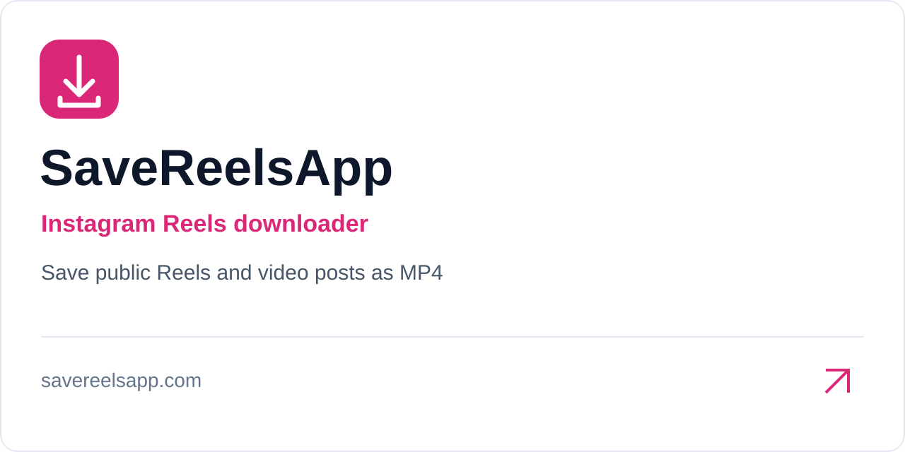
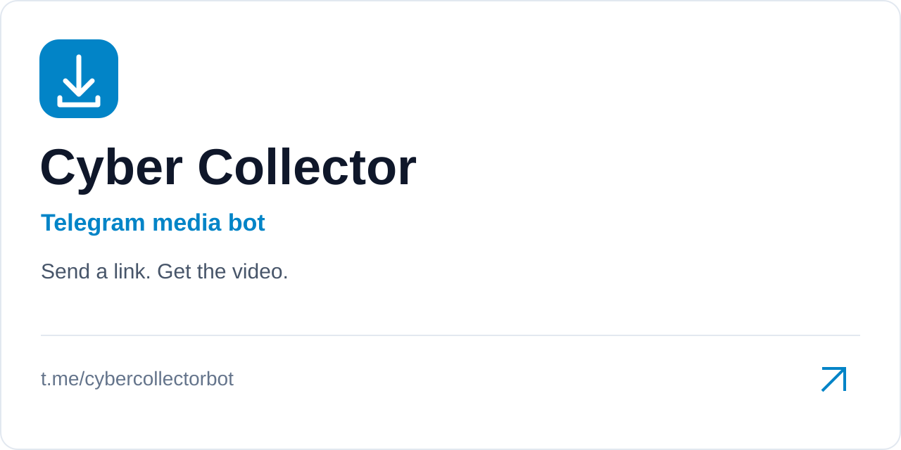

  
  <h1>Awesome Social Media Downloader</h1>

收录 YouTube、Bilibili、抖音等平台的媒体下载工具，以及相关的解析、录制与转写工具。

A curated list of social media downloaders and related media tools.

本仓库是工具索引。安装方法、支持平台与使用限制请查阅各工具的官方文档。

## 目录

- [下载工具](#下载工具)
- [媒体辅助工具](#媒体辅助工具)
- [在线下载服务](#在线下载服务)
- [Telegram 机器人](#telegram-机器人)
- [停止维护与待核实条目](#停止维护与待核实条目)
- [使用说明](#使用说明)
- [参与贡献](#参与贡献)
- [许可证](#许可证)
- [Star History](#star-history)

## 下载工具

|   **[lux](https://github.com/iawia002/lux)** |   **[gopeed](https://github.com/GopeedLab/gopeed)** |
| :---: | :---: |
|   **[N_m3u8DL-CLI](https://github.com/nilaoda/N_m3u8DL-CLI)** |   **[cobalt](https://github.com/imputnet/cobalt)** |
|   **[Bili23-Downloader](https://github.com/ScottSloan/Bili23-Downloader)** |   **[YoutubeDownloader](https://github.com/Tyrrrz/YoutubeDownloader)** |
|   **[wechatVideoDownload](https://github.com/qiye45/wechatVideoDownload)** |   **[Arroxy](https://github.com/antonio-orionus/Arroxy)** |
|   **[PowerToysRun-VideoDownloader](https://github.com/ruslanlap/PowerToysRun-VideoDownloader)** |  |

## 媒体辅助工具

|   **[video-analyse](https://github.com/ta867070117/video-analyse)** |   **[small-video-record](https://github.com/mabeijianxi/small-video-record)** |
| :---: | :---: |
|   **[bagaoji](https://github.com/hope0719/bagaoji)** |  |

## 在线下载服务

|  **[PullVid](https://pullvid.com)** YouTube、TikTok、Instagram、X、Facebook 等 在线下载与媒体格式转换。 |  **[curl-x](https://www.curl-x.com)** X、Instagram、TikTok、Facebook 等 支持网页入口和终端 `curl`。 |
| :---: | :---: |
|  **[VideoSaver](https://www.free-videodownload.com)** TikTok、Instagram、X、Facebook 等 通过公开链接下载，提供按平台划分的入口。 |  **[SaveReelsApp](https://savereelsapp.com/)** Instagram 通过公开链接下载 Reels 与视频帖（MP4），无需登录，可安装为 PWA。 |
|  **[InstaNoMark](https://instagramvideodownloadwithoutwatermaker.com)** Instagram 通过公开链接下载 Instagram 视频，无水印、无需登录。 | |

## Telegram 机器人

|  **[Cyber Collector](https://t.me/cybercollectorbot)** YouTube、Instagram、TikTok、X、Facebook 等 发送媒体链接获取视频。[官网](https://cybercollector.hitkey.io) | |
| :---: | :---: |

## 停止维护与待核实条目

|   **[downkyi](https://github.com/leiurayer/downkyi)** 官方已宣布停止维护并永久关停。 |   **[HellDownloader](https://github.com/ArkadyYum/HellDownloader)** 仓库内容与可用性待核实。 |
| :---: | :---: |

## 使用说明

1. 按用途选择工具，打开其官方仓库或网站。
2. 确认操作系统、目标平台、依赖和登录要求，再按官方文档安装或使用。
3. 下载失败时，先查看工具的版本说明和已知问题；工具本身的问题请反馈到对应项目。

请仅下载你有权获取和使用的内容，并遵守目标平台的服务条款。收录不代表对第三方工具的安全性、持续可用性或功能作出保证。

## 参与贡献

欢迎通过 [Issue](https://github.com/DangJin/awesome-social-media-downloader/issues) 反馈失效链接、描述错误或工具状态变化，也欢迎通过 Pull Request 补充工具。

提交条目时请：

- 优先提供官方仓库或官网，避免使用来源不明的下载链接。
- 放入对应分类，沿用现有卡片样式，提供封面、清晰的名称与链接；没有仓库卡片的服务可将封面存放在 `assets/covers/`。
- 核实支持平台、必要依赖及收费限制，避免使用未经证实的宣传性描述。
- 更新已有条目前先检查是否重复；发现停止维护或不可用的项目时注明依据。

## 许可证

本仓库采用 [MIT License](LICENSE)。收录的第三方工具与服务遵循各自的许可证及使用条款。

## Star History

